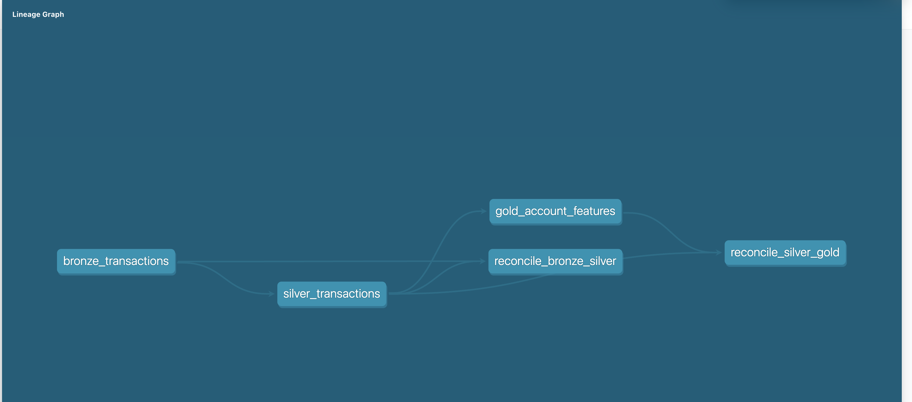

# Auditable AML Alert Triage

A personal project: a tested, documented data pipeline for anti-money-laundering (AML) transaction data, built as a **prototype on public synthetic data**.

**Live demo:** [analyst alert queue](https://manith-ops-auditable-aml-triage-appstreamlit-app-8womei.streamlit.app/) (200 sample alerts on public synthetic data; the audit log there is temporary and resets on restart; the free host may need a moment to wake up).

> **Status: work in progress.** Built: data pipeline, data-quality tests, CI, two rules, a time-split XGBoost model with SHAP reasons, MLflow tracking, and an analyst queue with an append-only audit log. The final test-set evaluation is done (scored once). **Not built yet:** LLM case summaries.

## Problem

AML monitoring produces many alerts and most of them turn out to be false positives. Analysts need alerts that are ranked, explained and auditable. This project starts with the foundation: a pipeline whose every layer is tested, reconciled and traceable.

## Data (synthetic, with a license)

- **IBM AMLworld synthetic transactions** (Kaggle: `ealtman2019/ibm-transactions-for-anti-money-laundering-aml`), HI-Small set: 5,078,345 transactions.
- License: **CDLA-Sharing 1.0**. The raw data is not committed or re-hosted here; a script downloads it.
- The data is **synthetic**. Labels come from a simulator, not from real investigations.
- CI uses a tiny **generated** file (2,000 fake rows), not the IBM data.

## What is built

```
raw CSV -> bronze -> silver -> gold
```

| Layer | What it does |
|---|---|
| **bronze** | The raw CSV loaded as-is (all text). Renames the two clashing "Account" columns and adds `raw_row_id` so every row can be traced to the source. |
| **silver** | Typed and cleaned: timestamps, amounts, label, account keys (bank + account), self-transfer and cross-currency flags. One row in, one row out; nothing is dropped. |
| **gold** | One row per account: sent/received counts, fan-in, fan-out, totals. |

Lineage (generated by `dbt docs`):



## Controls (tested)

- **26 dbt tests**: not-null and uniqueness checks, label must be 0 or 1, row and amount reconciliation between layers, and a leakage test that rebuilds each sender feature from earlier rows only.
- **Reconciliation**: bronze to silver (row count and total amount) and silver to gold (totals of sent/received counts and amounts). Row counts differ after grouping by design, so gold is reconciled on totals.
- **Bad-batch demo**: `scripts/make_bad_batch.py` copies 10,000 rows and injects 4 faults (bad date, non-numeric amount, label of 2, missing sender account). Running all 26 tests on it gives 5 failing tests (the missing sender account trips two), so every injected fault is caught. The real data passes all 26.
- **Evaluation discipline**: `docs/evaluation_plan.md` was committed before the test days were scored, and `scripts/evaluate_test.py` refuses a second test run unless `--rerun` is passed.
- **CI** (GitHub Actions): on every push it rebuilds the pipeline on the synthetic sample and runs all tests.

## Detection

- **Time-based split**, defined once in dbt: train Sep 1-6, validation Sep 7-8, test Sep 9-18. The test days were scored **once**, with the frozen model, after [the evaluation plan](docs/evaluation_plan.md) was committed.
- **Rules:** payment format is ACH; amount above 10,000.
- **Model:** XGBoost on features computed only from earlier transactions (windows end one row before the current one; a dbt test checks there is no leakage). Runs are tracked in MLflow with the git commit.
- **Reasons per alert:** SHAP contributions in plain language. These are model explanations, not legal reason codes.

### Test days (final evaluation)

863,900 transactions, 1,611 laundering (base rate 0.19%). Model v1 was not retrained or tuned after seeing these results.

| Measure | Model | ACH rule | Amount rule (>10,000) |
|---|---|---|---|
| PR-AUC | 0.1206 (random: 0.0019) | n/a | n/a |
| Top 0.1% of rows (864 alerts) | precision 24.5%, recall 13.2% (95% interval 11.5-14.8%), 3.1 false alerts per true alert | n/a | n/a |
| Top 0.5% of rows (4,320 alerts) | precision 12.6%, recall 33.9% (31.6-36.2%), 6.9 false alerts per true alert | n/a | n/a |
| Recall at the ACH rule's volume (120,303 alerts) | 95.4% | 92.4% | n/a |
| Recall at the amount rule's volume (214,782 alerts) | 99.9% | n/a | 53.1% |

"False alert" = an alert on a transaction whose simulator label is not laundering. Intervals are bootstrap intervals for recall and treat the alert set as fixed. A "combined" approach (rule-flagged rows first, then the model) did not beat the model alone.

**What this shows and does not show**
- At small alert budgets the model finds a minority of the laundering (13% and 34%). At large volumes (a quarter to a third of all rows) it ranks almost all of it inside the alerts, which is a coarse ranking.
- Its gain over the ACH rule at equal volume is about 3 points (95.4% vs 92.4%), on one run.
- Every laundering transaction with a listed pattern is almost entirely ACH (99-100%). Laundering with no listed pattern (371 of 1,611 rows, a group the IBM pattern file does not cover) is only 67% ACH, and it is the model's weakest group (86% recall at the ACH volume vs 96-100% for listed patterns). This looks like a simulator artifact, so these numbers say little about real laundering.
- Recall at the small budgets is low for every pattern type (about 8-20% at the top 0.1%). The 20 worst false positives and 20 worst misses are analysed in [docs/error_analysis.md](docs/error_analysis.md): all 20 false positives are ACH payments, and the worst misses are mostly small ACH payments or non-ACH laundering with no listed pattern.

### Validation days (used for model choices), one run (about 1 laundering transaction per 900 rows):

| Measure | Result |
|---|---|
| PR-AUC | 0.0899 (a random ranker scores 0.0011) |
| Top 1,000 alerts | precision 17.3%, recall 16.7% |
| Top 10,000 alerts | precision 5.7%, recall 55.0% |
| Same alert volume as the ACH rule (116,910 alerts) | model recall 92.6%, rule recall 85.9% |

**Honest reading:** SHAP shows the ACH flag dominating the reasons for every top alert, and amounts near 10,000 come second. The model mostly rediscovers the simple rules, which may be a simulator artifact. The small gain over the ACH rule at equal alert volume (92.6% vs 85.9%) is from one run on validation data and is not a claim of real-world performance.

Model details, limits and intended use: [docs/model_card.md](docs/model_card.md). Self-review with 12 findings: [docs/validation_report.md](docs/validation_report.md).

## Drift monitoring

`scripts/drift_psi.py` computes PSI (Population Stability Index) for the nine features and the model score, with no labels needed. Details in [docs/drift_monitoring.md](docs/drift_monitoring.md).

- Against the training days, amount and hour of day are stable, while payment format and the history features show large drift. Causes: one payment format ("Reinvestment") exists only in the training days, and history counts grow with time by construction. These alarms show the data changed, not that laundering behaviour did.
- In a clean demo (Sep 5 vs Sep 6), two simulated shifts (amounts x3, 20% of rows relabelled ACH) were each flagged on the feature that was changed, while the model-score PSI stayed below 0.10 for both. Feature-level monitoring caught what score-level monitoring missed.

## Analyst queue and audit log

- Streamlit app (`streamlit run app/streamlit_app.py`): ranked alerts, model reasons, and three decisions (escalate, dismiss, request more information).
- Every decision is written to a **SQLite audit log** that cannot be edited or deleted (database triggers block UPDATE and DELETE; tested).
- Nothing is filed automatically. The true label is never shown to the analyst.
- A 200-alert sample without labels (`demo/alerts_demo.csv`) lets the app run without the full data. See `demo/DATA_NOTICE.md` (CDLA-Sharing 1.0).

## Quickstart

Needs Python 3.12 and a Kaggle account.

```bash
python3 -m venv .venv && source .venv/bin/activate   # isolated environment
pip install -r requirements.txt                      # exact package versions
kaggle auth login                                    # one-time browser login to Kaggle
python scripts/download_data.py                      # downloads HI-Small into data/raw (git-ignored)
cd dbt && dbt run && dbt test                        # build bronze/silver/gold, then run all 26 tests
```

Without Kaggle (what CI does):

```bash
python scripts/make_sample_data.py
cd dbt && dbt build --target ci --vars '{raw_trans_path: ../data/sample/sample_trans.csv}'
```

**One command for the full rebuild** (after the download, with the virtual environment active and `pip install -r requirements-ml.txt` done for the model and app packages):

```bash
make all      # dbt build with all 26 tests, pattern link, model training, alert queue
```

`make all` re-ran end to end and reproduced the same validation numbers (PR-AUC 0.0899) and a byte-identical demo sample. The one-time test-set evaluation is deliberately not part of it (`make evaluate`). `make ci` runs what GitHub Actions runs.

## Design decisions

- **Medallion layers** so any number can be traced back to the source file.
- **Bad values become NULL in silver** (`try_cast`, `try_strptime`) and tests catch them, instead of crashing the build.
- **Account key = bank + account**, because an account ID is only unique within its bank.
- **Model features are time-aware.** The per-account gold table uses the whole time range (fine for an analyst view), so the model uses separate features built from earlier rows only.
- **Rules kept only if they catch something.** Cross-currency and self-transfer rules were dropped (0 and 6 laundering cases caught).
- **Row order is fixed (`ORDER BY raw_row_id`).** Without it, training results varied between runs (PR-AUC 0.080-0.090).

## Where this breaks

- Labels come from a simulator; a model may learn generator artifacts and the results will not transfer to a real bank.
- Reconciliation does not catch bad values that become NULL in both layers (the bad-batch demo shows this); the column tests do.
- Laptop-scale only (5M rows in DuckDB).
- No fairness audit: the data has no demographic attributes.
- The model largely rediscovers the ACH rule, so its extra value is unproven.
- The test period is Sep 9-18, but Sep 9-10 hold 99.9% of its rows (Sep 11-18 have 11-396 rows a day), so it is effectively two days. It is one run with no repeated splits, so stability on other time windows is unknown.
- The pattern file lists only 3,209 of the 5,177 laundering transactions, so "recall by pattern" leaves out the rest as its own group.
- The live demo's audit log is temporary and resets on restart.
- SHAP reasons are model explanations, not legal adverse-action codes.

## Next

A one-command rebuild, a deployed demo, a model card and validation report, and LLM-drafted case summaries that a human always reviews. ROC-AUC is not the headline metric.
